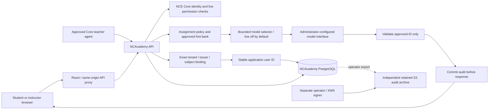

# Architecture

NCAcademy is a separate application with its own database and credentials. NCE Core provides production identity, authorization and deployment control. The same-origin React frontend calls the FastAPI service; PostgreSQL stores curriculum, work, sessions, settings and audit records. SQLite is confined to local development/testing.

## School, class and ownership boundaries

Core organization is the deployment tenant boundary. Schools are separate application scopes inside that tenant, with their own memberships, resources and classes. Admin accesses all application schools. A School administrator manages only assigned schools; this role does not confer Core organization administration. Teachers use permitted school resources and maintain classes to which they have teaching authority. Students can read only enrolled coursework and their own work/session records. Being an administrator does not make a student-owned submission editable. Submission snapshots preserve the actual work submitted; later draft edits cannot rewrite history. See the complete [permissions contract](permissions.md).

Authorization combines fresh Core capability checks, active local principal and school membership, school-resource visibility and class membership. Every lookup follows the target record's stored school/class scope; a caller-selected school ID is not authority. Resource catalogs expose only authorized descriptors. A school assignment adds an application ACL and never creates an upstream Core permission or integration grant.

Agent teachers are distinct nonhuman principals. They present short-lived Core agent credentials to the API; the backend uses its own scoped workload credential for Core's separate live agent-introspection endpoint. Human OIDC credentials, agent credentials and backend workload credentials are not interchangeable. Agent approvals, consumer, environment, task, permissions and local school/class assignments must all remain valid. Agents cannot grant roles, become administrators, obtain provider secrets or write student work. Approved agent Teachers can read immutable submissions and, with a current audit grant, assistance history in their assigned classes; recorded saved-draft versions remain part of explicitly authorized session evidence, while direct student-draft endpoints remain student-owned.

`core_identity_bindings` resolves the verified Core tenant, issuer and subject to a stable application user record. A unique tenant/issuer/user constraint prevents two Core subjects from sharing one owner within an authority. Login and live session checks reject foreign-tenant, non-user, disabled or mismatched targets. A same-issuer legacy hash can be adopted during sign-in. Moving the authority origin requires an explicit operator backfill; email and names never link identities. Both reviewed issuer aliases can point to the same existing user, allowing configuration rollback without changing coursework or historical audit IDs. The API can select/insert bindings but cannot update/delete them; no public API accepts binding mutations. See [issuer migration](core-issuer-migration.md).

Before creating a completely new local user, every existing tenant user must already have a binding under the configured issuer. A configuration-only authority change therefore fails closed until the operator backfill. An exact same-issuer legacy owner can still be adopted, and an empty tenant can admit its first valid Core user. During a legacy upgrade, bind existing owners before admitting additional users.

## Assistance boundary

Teacher configuration is separate from identity. Human School/Admin manages shared human/AI profile metadata and explicit immutable approval. Managed AI profiles grant no Core authority; an approved profile/course/public corpus/model policy can serve bounded Lesson Q&A to enrolled students. Advanced Core-bound teachers additionally retain actual class placement, live Core authority and agent gates. Missing or revoked bindings never fall back to managed mode.

Each course owns its curriculum configuration and content-addressed knowledge corpus. Reviewed state adapters supply structured standards/provenance and public teaching summaries; scoped school text can supplement them with explicit audience. The initial NY 2026–2027 environmental-science mapping is partial. Exact approved public teaching excerpts alone may reach Lesson Q&A; private teacher materials and standards summaries are excluded. An LLM selects an admitted document ID, then trusted server code renders an exact passage, citation and fixed style text. Model prose, tools and student-work writing are excluded. Profile, corpus and connection edits invalidate admission around send/release.

Lesson Q&A uses separate durable course turns, shared student/course daily UTC quotas across profiles, a pre-send marker and terminal audit evidence. It does not receive or update a student draft. Authorized reviewers replay its actual context, source candidates and release decisions through the existing session audit surface. Assignments, materials and feedback still require human publication approval. See [teachers and standards](teachers-and-standards.md).

Private student-curated lessons use the same course-turn lifecycle with `activity: curated_lesson`. Written task context and optional normalized assignment photos guide one bounded source/media selection. Photos are encrypted in the turn record and reconstructed only for the approved image-capable model or protected current student/reviewer reads. Audit/replay contains metadata, hashes and scoped endpoints rather than embedded photos or ciphertext. Trusted server code assembles exact public-source text, versioned interactive visual descriptors and fixed reflection prompts. Browser read-aloud uses the same teaching text; explicit student progress/reflections enter the session audit. Curation is a separate approved opt-in and shares Q&A's daily limits, idempotency and pending-send barriers. It creates no shared class publication or student-work write. See [the curation contract](student-curated-lessons.md).

A student submits an attempt and a tutoring question. The server resolves the assignment and effective policy itself, checks membership and ownership, records the request and reserves the bounded turn before any provider call. The allowed output is a selection from the assignment's approved hint/question bank. Context contains only the authorized bounded assignment/student session content needed for that selection. Provider output is untrusted.

The server accepts the exact response schema and an ID from the current immutable bank snapshot; extra prose, unknown IDs, malformed responses, missing/invalid usage, unavailable models and exhausted limits fail closed. It renders the stored text for that ID. Prompt injection cannot introduce a new answer string through the provider response. Teachers must review their authored hints: the system cannot establish that a teacher's hint contains no answer.

Disabled assistance makes no provider call. Assignment curated mode progresses through approved hints without inference; Socratic selection chooses approved questions using an explicitly enabled, administrator-allowed model connection. The separate private curation route alone accepts bounded task photos. Neither interface admits arbitrary tools, browser actions, document authoring or student-editable system instructions.

## Audit and evidence

Durable events preserve student input/attempt versions, assignment and policy snapshots, the actual bounded model request, nonsecret model binding, sanitized visible selection response, normalized usage and released approved text. A send marker commits before external I/O. Output is withheld until the completion audit commits. Requests use idempotency keys; a pending/uncertain operation must not cause another inference. Instructor read/export access is itself audited.

A hash chain detects modifications relative to a trusted exported head. Database permissions protect application append-only behavior. Neither mechanism alone prevents a database owner from rewriting history or removing the tail. The restricted API database role cannot update/delete/truncate audit events or perform schema DDL. It can advance the mutable audit head as part of appending events. Independent retained exports, operator-run KMS-signed checkpoints and backup/restore verification are production prerequisites; see [audit controls](audit.md). Session replay shows observable student work and assistance. It does not expose or reconstruct a model's hidden chain of thought and cannot establish how a student reasoned outside this service.

## Administrative UX reuse

The fixed dark green sidebar, light workspace, administrative tab strip, integration cards and configuration modal follow Proposal Studio. Domain concepts map as school → classes → modules → assignments → student work/review. Administrative controls follow the active school and server-returned capabilities. Students cannot choose arbitrary endpoints, enable models or change a policy. Approving a teacher agent grants only its scoped teaching operations; it never grants autonomous assignment completion or an unrestricted student-facing model channel.

## Runtime and release

Containers use nonroot identities, health/readiness probes and explicit schema migration. Production database and external bootstrap secrets remain independent of images. The frontend contains no secrets. The dedicated `amplify-academy-fargate` recipe and exact repository CI policy adapt Core's deployment conventions for NCAcademy. Owner-only migration and API tasks use distinct execution roles and database secrets. The API has no AWS task role and cannot sign or retain its own external checkpoints. See [deployment](deployment.md) and the [Core onboarding guide](../nce/README.md) for the exact adoption boundary. Registration alone provisions no running application.

## External teaching review boundary

`external_review.py` owns school audit-agent configuration, immutable source/review/publication snapshots and sealed review jobs; `youtube.py` owns exact URL parsing, fixed public metadata transport and generated embed URLs. The corpus builder exposes a recursion-free raw source view for imports, then applies current registry proofs to public teaching sources. Review proof changes alter the corpus snapshot and require normal corpus/profile reapproval. The same proof flows into Q&A citations and private multimedia sections. Student history projects withdrawn content without mutating original evidence. Browser players remain absent until explicit current-server admission; reviewer replay stays inert. Audit-agent configuration grants no Core identity or administrative permissions. See [external media review](external-media-review.md).
