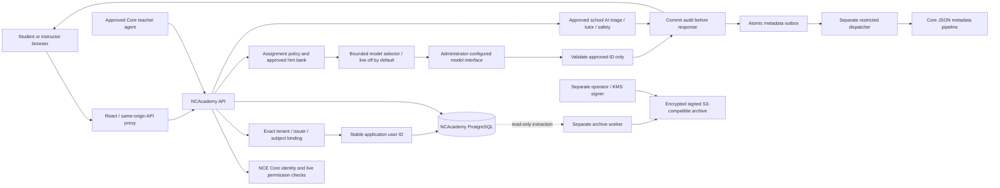

# Architecture

The [student avatar boundary](student-avatars.md) keeps every unreviewed candidate private. A separately approved image-scanning policy admits only structured risk scores; fixed server rules quarantine sexual material and flag violence/other concerns for human review. Unavailable or uncertain scanning remains hidden. Exact consent, current student/school authority, immutable scan/review evidence and independent PII encryption protect all Student identities. Schema 15 adds protected avatar evidence without changing Core student identities or adding public image hosting.

The [Game Studio integration](game-studio.md) keeps authoring in Game Studio's own staff-authorized workspace. Academy reads only its public data contract, imports exact published game definitions into immutable local packages and owns each class/lesson association and human approval. Students receive a currently admitted snapshot through Academy and play it in a fixed opaque-origin, no-network engine. No student identity, content or score is sent upstream. Schema 14 protects the game connection revisions, packages and approval evidence. [Assignment scoring](game-assignment-scoring.md) adds host-owned scales and repeat-attempt policies with encrypted, immutable server-admitted attempts, client observations and separate human awards under schema 16. Scoring binds the exact course/game/policy/runtime context; browser reports remain provisional. The `game-studio-data-v2` wrapper contract requires renewed human approval while retaining the same fixed engine. Future agent authoring and curated-lesson game selection need explicit new contracts.

Verified connection revisions expose a persistent creator shortcut only to human Admin/School administrators. A verified exact host may request `login=auto`; Game Studio then performs its own authorization-code/PKCE flow with Core and its own service audience. Core's existing browser session supplies shared sign-in, while each application's current grants remain independent. Academy never forwards tokens or makes local Student/Parent identities into Core accounts. Navigation changes preserve the existing schema-16 snapshots, approval/runtime contract and score evidence.

The [administrative workspace](administrative-settings.md) uses searchable integration, agent and skill catalogs and a school-scoped activity view. Administrative profiles are application job definitions, separate from Core identities and teacher personas. Registered local actions inspect readiness and prepare reviewed-source planning drafts; optional model review produces bounded advisory output under explicit prices, budgets and the deployment gate. It receives no student content and cannot approve, publish, change policy or grant access. Schema 13 adds protected revisions and run evidence while preserving earlier immutable kinds, identity bindings and encrypted student audit records.

Teacher identity/personality and course corpora remain independent of separately human-approved model execution policies. Schema 12 protects immutable model revisions/approvals while a scoped pointer selects the active policy. Lesson execution uses its fixed primary; opted-in Homework text handoffs use the teacher primary under the school budget and independent safety pass. Routing candidates/rules produce local previews only. See [teacher models](teacher-models.md) for execution/replay boundaries and the cost-aware routing plan.

NCAcademy is a separate application with its own database and credentials. NCE Core provides staff identity, staff authorization and deployment control. Platform-local students and parents use separately administered username/password identities with no upstream provisioning. The same-origin React frontend calls the FastAPI service; PostgreSQL stores curriculum, work, sessions, settings and audit records. SQLite is confined to local development/testing.

## School, class and ownership boundaries

The [local family account boundary](family-accounts.md) admits only Student/Parent roles, independent of Core availability. Current local status, credential/session version and school/class enrollment are checked on requests; a local account cannot acquire staff authority. Parent eligibility requires an enrolled local child and only exposes aggregate current progress. Schema 10 adds immutable encrypted lifecycle evidence; it preserves historical records and chains. A separate AES-256-GCM PII key protects new local-family profiles, credentials, educational payloads and related audit payloads. Hashes cover ciphertext; authorized replay supplies a separate decrypted view. Core identity resolution and issuer backfill explicitly exclude local family identities. No Google account linking, Core Chat or Core resource authorization is admitted for them.

Core organization is the deployment tenant boundary. Schools are separate application scopes inside that tenant, with their own memberships, resources and classes. Admin accesses all application schools. A School administrator manages only assigned schools; this role does not confer Core organization administration. Teachers use permitted school resources and maintain classes to which they have teaching authority. Students can read only enrolled coursework and their own work/session records. Being an administrator does not make a student-owned submission editable. Submission snapshots preserve the actual work submitted; later draft edits cannot rewrite history. See the complete [permissions contract](permissions.md).

Authorization combines fresh Core capability checks, active local principal and school membership, school-resource visibility and class membership. Every lookup follows the target record's stored school/class scope; a caller-selected school ID is not authority. Resource catalogs expose only authorized descriptors. A school assignment adds an application ACL and never creates an upstream Core permission or integration grant.

Agent teachers are distinct nonhuman principals. They present short-lived Core agent credentials to the API; the backend uses its own scoped workload credential for Core's separate live agent-introspection endpoint. Human OIDC credentials, agent credentials and backend workload credentials are not interchangeable. Agent approvals, consumer, environment, task, permissions and local school/class assignments must all remain valid. Agents cannot grant roles, become administrators, obtain provider secrets or write student work. Approved agent Teachers can read immutable submissions and, with a current audit grant, assistance history in their assigned classes; recorded saved-draft versions remain part of explicitly authorized session evidence, while direct student-draft endpoints remain student-owned.

`core_identity_bindings` resolves the verified Core tenant, issuer and subject to a stable application user record. A unique tenant/issuer/user constraint prevents two Core subjects from sharing one owner within an authority. Login and live session checks reject foreign-tenant, non-user, disabled or mismatched targets. A same-issuer legacy hash can be adopted during sign-in. Moving the authority origin requires an explicit operator backfill; email and names never link identities. Both reviewed issuer aliases can point to the same existing user, allowing configuration rollback without changing coursework or historical audit IDs. The API can select/insert bindings but cannot update/delete them; no public API accepts binding mutations. See [issuer migration](core-issuer-migration.md).

Before creating a completely new local user, every existing tenant user must already have a binding under the configured issuer. A configuration-only authority change therefore fails closed until the operator backfill. An exact same-issuer legacy owner can still be adopted, and an empty tenant can admit its first valid Core user. During a legacy upgrade, bind existing owners before admitting additional users.

## Google Classroom companion

The [Classroom workspace](google-classroom.md) pairs transient read-only Google assignment data with the existing private Homework Help. Native Google editing/submission opens through an admitted Classroom link. NCE Core remains the app identity; a consenting human Student connects a separate Google subject to their own school-scoped encrypted account and local-course mapping. Neither a shared class nor a School/Admin role exposes another student's Google data.

Server OAuth uses exact login-bound one-use state, PKCE and a fixed callback. Every external operation reserves safe local evidence before I/O and revalidates current local authority and connection/link/configuration revisions before release. Refresh and remote-revoke uncertainty cannot trigger automatic retries. Schema 9 protects only safe events/receipts; Google text, account identifiers and tokens remain outside immutable audit/session evidence. The help handoff supplies the local course, leaving the student to author the question. Own connection cleanup remains available after enrollment loss. The [Google contract](google-classroom-contract.md) records supported integration/embedding and activation requirements.

## Group conversations

The [Groups integration](group-chat.md) uses NCE Core Chat for message storage and an application-owned registry for school/class discovery, joins, invitations and required class membership. The installation is the sole upstream participant; local enrollment revocation therefore gates every subsequent browser/agent read and send without an upstream removal race. A managed persona is not a chat principal. Actual Core-bound agents retain their own current class authority and propose shared posts for human School/Admin approval.

Core application/AI sender records bind to immutable local commands and exact delivery receipts carrying the actual actor. Only matching messages are projected; upstream text and reply previews are never identity authority. Markers commit before I/O and receipt/audit before output. Core message IDs support explicit same-command retries; non-idempotent uncertain room creation requires operator reconciliation. Schema 8 protects chat evidence and seals terminal attempts. Core transport, workload provisioning and package grants are documented separately in the [contract](core-chat-contract.md).

## Class selection and assistance boundaries

Class identity is independent of instructional coverage. The packaged NYSED SCED workbook supplies all 2,030 official 2026–2027 course entries, including practical/performance/PE/arts/CTE subjects, with exact source receipts and no request-time network lookup. A separate verified state-assessment source drives Regents discovery. Course creation stores a server-resolved catalog snapshot only when selected; custom classes can have neither a catalog binding nor state standards, regardless of school curriculum. This uses existing course records with no new schema/grants. Missing AI teaching material cannot remove a class option. Optional `curriculum` still governs the separate standards/corpus preparation described below. See [course selection](ny-course-catalog.md).

School setup owns a versioned curriculum intent independent of each class's effective teaching configuration. A deterministic reviewed-source planning agent snapshots installed jurisdiction packages and drafts local grade/subject/year courses. A human explicitly materializes selected classes through an immutable idempotent publication receipt; each class retains its exact school-curriculum origin. Logo/custom metadata, state/custom/no-curriculum selection, the teaching team and saved run evidence share a resumable administrative workspace. Custom ingestion is an extension point, not an active parser. Teacher assignment records the actual per-class corpus preparation in a separate immutable knowledge-workflow run. Schema 7 protects these receipts; none grants Core capabilities or teaching approval. See [school onboarding](school-onboarding.md).

Curriculum scope reviews are distinct from exact standard/teaching packages. Four explicit New York 2026–2027 bundles represent Pre-K–12 subjects, genuine grade/proficiency bands, framework editions, local electives, source evidence and transitions. Planning can use these reviewed topics without fabricating standard codes. A reference-only corpus remains unverified and cannot be approved for teaching; installing a scope review never creates lesson excerpts or widens model output. Review hashes participate in planning and reference-snapshot identity. See the [curriculum review](ny-curriculum-2026-review.md).

Teacher configuration is separate from identity. Human School/Admin manages shared human/AI profile metadata and explicit immutable approval. Managed AI profiles grant no Core authority; an approved profile/course/public corpus/model policy can serve bounded Lesson Q&A to enrolled students. Advanced Core-bound teachers additionally retain actual class placement, live Core authority and agent gates. Missing or revoked bindings never fall back to managed mode.

Each course owns its curriculum configuration and content-addressed knowledge corpus. Reviewed state adapters supply structured standards/provenance and public teaching summaries; scoped school text can supplement them with explicit audience. The initial NY 2026–2027 environmental-science mapping is partial. Exact approved public teaching excerpts alone may reach Lesson Q&A; private teacher materials and standards summaries are excluded. An LLM selects an admitted document ID, then trusted server code renders an exact passage, citation and fixed style text. Model prose, tools and student-work writing are excluded. Profile, corpus and connection edits invalidate admission around send/release.

Lesson Q&A uses separate durable course turns, shared student/course daily UTC quotas across profiles, a pre-send marker and terminal audit evidence. It does not receive or update a student draft. Authorized reviewers replay its actual context, source candidates and release decisions through the existing session audit surface. Assignments, materials and feedback still require human publication approval. See [teachers and standards](teachers-and-standards.md).

Private student-curated lessons use the same course-turn lifecycle with `activity: curated_lesson`. Written task context and optional normalized assignment photos guide one bounded source/media selection. Photos are encrypted in the turn record and reconstructed only for the approved image-capable model or protected current student/reviewer reads. Audit/replay contains metadata, hashes and scoped endpoints rather than embedded photos or ciphertext. Trusted server code assembles exact public-source text, versioned interactive visual descriptors and fixed reflection prompts. Browser read-aloud uses the same teaching text; explicit student progress/reflections enter the session audit. Curation is a separate approved opt-in and shares Q&A's daily limits, idempotency and pending-send barriers. It creates no shared class publication or student-work write. See [the curation contract](student-curated-lessons.md).

A student submits an attempt and a tutoring question. The server resolves the assignment and effective policy itself, checks membership and ownership, records the request and reserves the bounded turn before any provider call. The allowed output is a selection from the assignment's approved hint/question bank. Context contains only the authorized bounded assignment/student session content needed for that selection. Provider output is untrusted.

The server accepts the exact response schema and an ID from the current immutable bank snapshot; extra prose, unknown IDs, malformed responses, missing/invalid usage, unavailable models and exhausted limits fail closed. It renders the stored text for that ID. Prompt injection cannot introduce a new answer string through the provider response. Teachers must review their authored hints: the system cannot establish that a teacher's hint contains no answer.

Disabled assistance makes no provider call. Assignment curated mode progresses through approved hints without inference; Socratic selection chooses approved questions using an explicitly enabled, administrator-allowed model connection. The separate private curation route alone accepts bounded task photos. Neither interface admits arbitrary tools, browser actions, document authoring or student-editable system instructions.

## Exact Grade 3 mathematics package

The installed [New York Grade 3 mathematics package](ny-grade3-mathematics.md) adds complete standards mapping for the exact 2026–2027 grade/year: 52 standards/practice records, 27 original teaching references and a nine-unit local sequence. This is a locally authored reference and starting syllabus, not a full published lesson or assessment bank. The two high-school science packages remain partial; other grade/subject contexts retain their existing preparation boundaries. The same immutable corpus, source-review, human approval and student-authorship controls apply. [Exact OpenAI model transport compatibility](openai-chat-compatibility.md) changes request parameters within the existing approved cap without widening this teaching authority.

## Homework Help and speech

The school AI mode is separate from the legacy selector flow below. It works with zero course enrollments and supports enrolled coursework when available. Human approval pins the school assistant and three model/connection snapshots: triage/direct help, AI teacher responses and independent output review. Triage either supplies its own bounded reply in the same operation or hands off to a matching currently approved school AI persona. Independent safety review gates both paths. An optional school approval admits public AI-teacher identity/behavior outside enrolled classes, without exposing class materials or expanding class-teacher review. The server controls candidate AI teachers, enrolled-course descriptors, optional enrollment-gated approved passages, citations, bounded conversation context and personal learning weights. The provider-neutral browser workspace places conversations on the left and the active chat/composer on the right; no course selection is required before asking. A strict plain-text answer and safety verdict gate generated explanations. No tools, student-work writes or shared publication are granted; completion controls reduce risk rather than guarantee correctness or perfect refusal. Three-model image capability and explicit student consent are required for photos. Schema 11 protects immutable configuration/approval/session/send records and sealed terminal messages. Local-family evidence uses the independent PII key. See [the complete AI and legacy contracts](homework-help.md).

Each phase commits its own durable send marker and checks current authority/configuration before I/O. Terminal audit commits before display. A transport/crash uncertainty is never automatically resent. School/Admin replay includes the full school conversation; current class Teachers/authorized agents receive only that class's interactions, excluding other courses/general questions and complete provider prompts. The existing structured feedback adapts bounded personal weights under a stable school assistant scope. Voice remains deferred for generated replies.

The student-owned Homework Help conversation is pinned to one school. A narrow triage component ranks currently enrolled, admitted course descriptors; ambiguity or photo-only context requires a student course choice. Handoff invokes the existing curated-lesson lifecycle with an exact approved teacher, corpus and model policy. Follow-up context is bounded to currently admitted prior questions for that same class/persona. Server-generated references point only to current coursework. Immutable messages/outcomes link to sealed course turns; explicit recovery of a request interrupted before admission reuses its original lesson key. Independent message/photo-storage budgets also count clarification and blocked requests.

Optional ElevenLabs speech uses a school-scoped encrypted connection and an independently fixed stock catalog. A personal voice revision follows the stable teacher. Bounded microphone recordings become editable transcripts; students explicitly send the question. Read-aloud accepts only an owned released turn ID and derives the exact text on the server. Neither voice direction creates a new unrestricted tutoring model path. Before-send/release/playback authorization, durable markers, quotas and uncertainty apply. Raw microphone bytes do not enter persistent records or audit; transcripts, exact spoken text and processing evidence do. Generated playback is encrypted and privately served. Schema 6 protects Homework messages/outcomes, personal voice revisions and completed speech operations. See [Homework Help](homework-help.md) and [voice](homework-voice.md).

## Audit and evidence

Every audit append also inserts an allowlisted metadata outbox event in the same transaction. A separate dispatcher, with no raw audit/record/PII-key access, sends stable event IDs to Core's existing JSON pipeline. Core contains hashes, opaque correlated references, status, phase and bounded usage only. Recoverable leases, destination binding, duplicate reconciliation and immutable receipts support asynchronous delivery after local evidence is durable. Failed delivery does not resend a model request. The independently encrypted archive continues to preserve original audit ciphertext; delivery health and archive freshness remain separate checks. See [delivery and operational activation](audit-delivery.md).

Student learning preferences are a separate personal layer over approved teaching configuration. Nine structured intake answers initialize bounded numeric presentation weights. Immutable per-interaction feedback contributes only to that student's teacher-specific adjustment. Accuracy concerns remain review evidence. Preferences cannot grant capabilities, admit sources or alter factual content. Each new tutoring operation pins the exact preference revision and effective weights and revalidates them before external send and release. School-wide teacher metadata and other students' weights are unaffected. The additive schema-5 migration preserves earlier identities and evidence. See [learning preferences](student-learning-preferences.md).

Durable events preserve student input/attempt versions, assignment and policy snapshots, the actual bounded model request, nonsecret model binding, sanitized visible selection response, normalized usage and released approved text. A send marker commits before external I/O. Output is withheld until the completion audit commits. Requests use idempotency keys; a pending/uncertain operation must not cause another inference. Instructor read/export access is itself audited.

A hash chain detects modifications relative to a trusted exported head. Database permissions protect application append-only behavior. Neither mechanism alone prevents a database owner from rewriting history or removing the tail. The restricted API database role cannot update/delete/truncate audit events or perform schema DDL. It can advance the mutable audit head as part of appending events. Independent retained exports and backup/restore verification are production prerequisites; operator-run KMS checkpoints remain supported. This revision also packages a separate read-only archive worker with encrypted signed segments, conditional object creation and independently retained heads, targeting private S3-compatible storage. A Kubernetes storage package is separate from the current Fargate recipe. Cluster administrators and the archive/signing authority remain explicit trust boundaries; see [session archiving](session-archive.md) and [audit controls](audit.md). Session replay shows observable student work and assistance. It does not expose or reconstruct a model's hidden chain of thought and cannot establish how a student reasoned outside this service.

## Administrative UX reuse

Human class managers use a dedicated [enrollment projection](course-enrollment.md) for student names and current school grade/year. Authorization is resolved from the course and current school membership before private profiles are decrypted. The general directory and agent-facing roster remain pseudonymous. Name searches use bounded POST bodies, and read audits contain opaque scope/count metadata. Grade matching is a default picker filter and never changes a student's school placement, grade or authority.

The fixed dark green sidebar, light workspace, administrative tab strip, integration cards and configuration modal follow Proposal Studio. Domain concepts map as school → classes → modules → assignments → student work/review. Administrative controls follow the active school and server-returned capabilities. Students cannot choose arbitrary endpoints, enable models or change a policy. Approving a teacher agent grants only its scoped teaching operations; it never grants autonomous assignment completion or an unrestricted student-facing model channel.

## Runtime and release

Containers use nonroot identities, health/readiness probes and explicit schema migration. Production database and external bootstrap secrets remain independent of images. The frontend contains no secrets. Core's exact repository CI and existing reviewed hosting binding deploy NCAcademy to its consolidated Lightsail API and retained Amplify frontend. The historical `amplify-academy-fargate` manifest archetype does not change that bound destination. Owner-only migration and API tasks use distinct execution roles and database secrets. The API has no AWS task role and cannot sign or retain its own external checkpoints. See [deployment](deployment.md) and the [Core onboarding guide](../nce/README.md) for the exact adoption boundary. Registration alone provisions no running application.

## External teaching review boundary

`external_review.py` owns school audit-agent configuration, immutable source/review/publication snapshots and sealed review jobs; `youtube.py` owns exact URL parsing, fixed public metadata transport and generated embed URLs. The corpus builder exposes a recursion-free raw source view for imports, then applies current registry proofs to public teaching sources. Review proof changes alter the corpus snapshot and require normal corpus/profile reapproval. The same proof flows into Q&A citations and private multimedia sections. Student history projects withdrawn content without mutating original evidence. Browser players remain absent until explicit current-server admission; reviewer replay stays inert. Audit-agent configuration grants no Core identity or administrative permissions. See [external media review](external-media-review.md).
