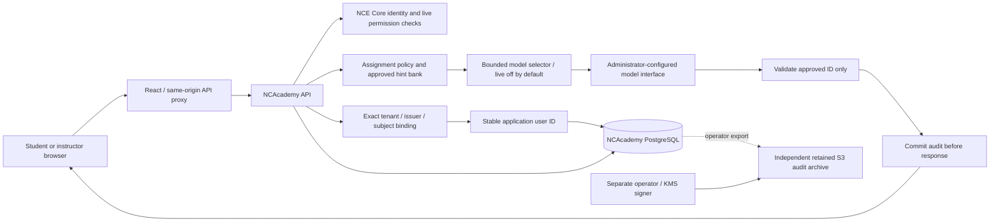

# Architecture

NCAcademy is a separate application with its own database and credentials. NCE Core provides production identity, authorization and deployment control. The same-origin React frontend calls the FastAPI service; PostgreSQL stores curriculum, work, sessions, settings and audit records. SQLite is confined to local development/testing.

## Course and ownership boundaries

Core organization is the tenant boundary. Instructors/admins manage course membership and assignments. Students can read only enrolled coursework and their own work/session records. Being an administrator does not make a student-owned submission editable. Submission snapshots preserve the actual work submitted; later draft edits cannot rewrite history.

`core_identity_bindings` resolves the verified Core tenant, issuer and subject to a stable application user record. A unique tenant/issuer/user constraint prevents two Core subjects from sharing one owner within an authority. Login and live session checks reject foreign-tenant, non-user, disabled or mismatched targets. A same-issuer legacy hash can be adopted during sign-in. Moving the authority origin requires an explicit operator backfill; email and names never link identities. Both reviewed issuer aliases can point to the same existing user, allowing configuration rollback without changing coursework or historical audit IDs. The API can select/insert bindings but cannot update/delete them; no public API accepts binding mutations. See [issuer migration](core-issuer-migration.md).

Before creating a completely new local user, every existing tenant user must already have a binding under the configured issuer. A configuration-only authority change therefore fails closed until the operator backfill. An exact same-issuer legacy owner can still be adopted, and an empty tenant can admit its first valid Core user. During a legacy upgrade, bind existing owners before admitting additional users.

## Assistance boundary

A student submits an attempt and a tutoring question. The server resolves the assignment and effective policy itself, checks membership and ownership, records the request and reserves the bounded turn before any provider call. The allowed output is a selection from the assignment's approved hint/question bank. Context contains only the authorized bounded assignment/student session content needed for that selection. Provider output is untrusted.

The server accepts the exact response schema and an ID from the current immutable bank snapshot; extra prose, unknown IDs, malformed responses, missing/invalid usage, unavailable models and exhausted limits fail closed. It renders the stored text for that ID. Prompt injection cannot introduce a new answer string through the provider response. Teachers must review their authored hints: the system cannot establish that a teacher's hint contains no answer.

Disabled assistance makes no provider call. Curated assistance can progress through approved hints without inference. Socratic selection chooses from approved questions using an explicitly enabled, administrator-allowed model connection. There are no arbitrary tools, browser actions, document authoring, uploads or student-editable system instructions.

## Audit and evidence

Durable events preserve student input/attempt versions, assignment and policy snapshots, the actual bounded model request, nonsecret model binding, sanitized visible selection response, normalized usage and released approved text. A send marker commits before external I/O. Output is withheld until the completion audit commits. Requests use idempotency keys; a pending/uncertain operation must not cause another inference. Instructor read/export access is itself audited.

A hash chain detects modifications relative to a trusted exported head. Database permissions protect application append-only behavior. Neither mechanism alone prevents a database owner from rewriting history or removing the tail. The restricted API database role cannot update/delete/truncate audit events or perform schema DDL. It can advance the mutable audit head as part of appending events. Independent retained exports, operator-run KMS-signed checkpoints and backup/restore verification are production prerequisites; see [audit controls](audit.md). Session replay shows observable student work and assistance. It does not expose or reconstruct a model's hidden chain of thought and cannot establish how a student reasoned outside this service.

## Administrative UX reuse

The fixed dark green sidebar, light workspace, administrative tab strip, integration cards and configuration modal follow Proposal Studio. Domain concepts map as courses → modules → assignments → student work/review. Administrators configure model interfaces in settings; students cannot choose arbitrary endpoints, enable models or change a policy. Proposal-generation and autonomous-agent actions are excluded from educational workflows.

## Runtime and release

Containers use nonroot identities, health/readiness probes and explicit schema migration. Production database and external bootstrap secrets remain independent of images. The frontend contains no secrets. The dedicated `amplify-academy-fargate` recipe and exact repository CI policy adapt Core's deployment conventions for NCAcademy. Owner-only migration and API tasks use distinct execution roles and database secrets. The API has no AWS task role and cannot sign or retain its own external checkpoints. See [deployment](deployment.md) and the [Core onboarding guide](../nce/README.md) for the exact adoption boundary. Registration alone provisions no running application.
